# US17 — Class diagrams

UML class diagrams for every class introduced by US17 (guest cart, PR #1).
Each diagram is written in [Mermaid](https://mermaid.js.org/syntax/classDiagram.html) (`src/*.mmd`) and rendered to PNG.

Regenerate the images after editing a `.mmd` file (needs Node.js ≥ 22.13):

```bash
./docs/uml/render.sh US17
```

Notation: `+` public, `-` private, `#` protected, `~` package-private (Java) · underlined = static ·
«…» = stereotype (Spring/Angular role, record, interface) · ◆ composition, ◇ aggregation, → association, ⇢ dependency.

## Overview

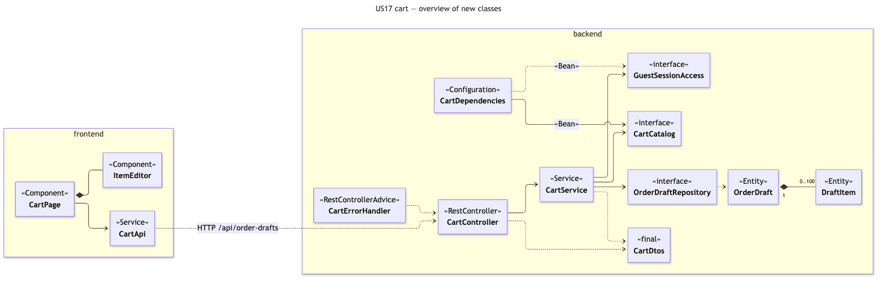

## Backend (`de.oth.swgigbackend.cart`)

| Class | Kind | Diagram |
|---|---|---|
| `CartController` | REST controller | [CartController.png](CartController.png) |
| `CartService` | service | [CartService.png](CartService.png) |
| `CartErrorHandler` | controller advice | [CartErrorHandler.png](CartErrorHandler.png) |
| `CartDtos` (+ `ExtraInput`, `ItemInput`, `ExtraView`, `ItemView`, `DraftView`, `ProductPage`) | DTO records | [CartDtos.png](CartDtos.png) |
| `CartCatalog` (+ `Product`, `Extra`) | port interface | [CartCatalog.png](CartCatalog.png) |
| `GuestSessionAccess` | port interface | [GuestSessionAccess.png](GuestSessionAccess.png) |
| `CartDependencies` | Spring configuration | [CartDependencies.png](CartDependencies.png) |
| `OrderDraft` | JPA entity | [OrderDraft.png](OrderDraft.png) |
| `DraftItem` | JPA entity | [DraftItem.png](DraftItem.png) |
| `OrderDraftRepository` | Spring Data repository | [OrderDraftRepository.png](OrderDraftRepository.png) |

### CartController
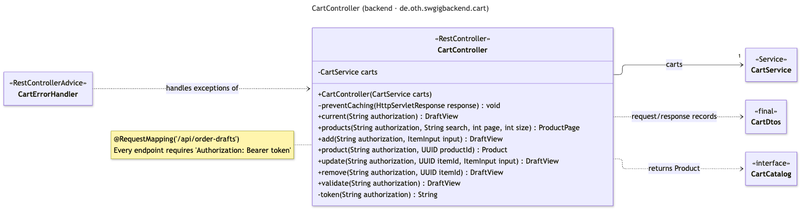

### CartService
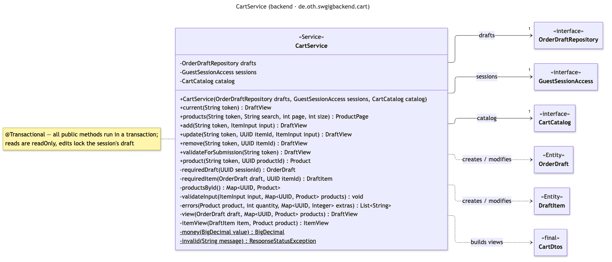

### CartErrorHandler
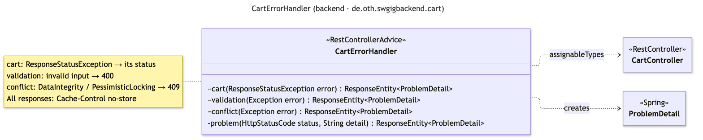

### CartDtos
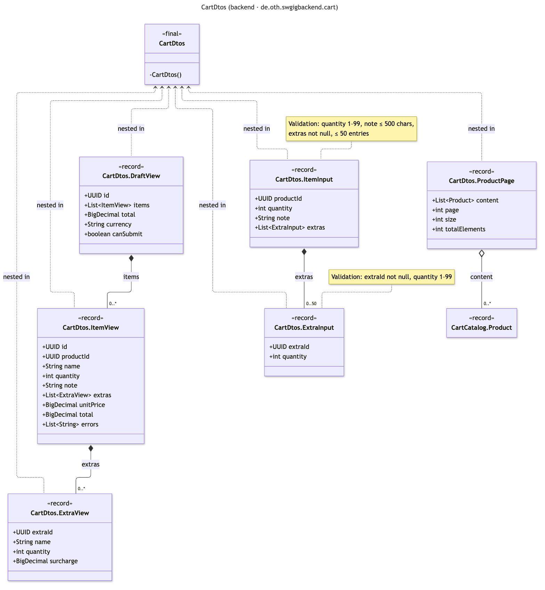

### CartCatalog
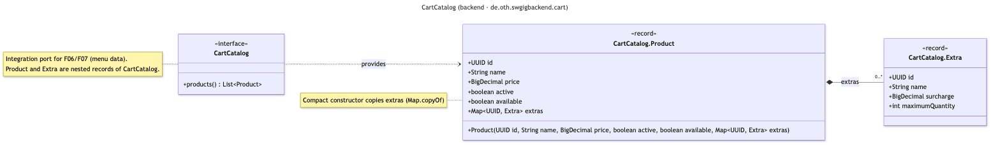

### GuestSessionAccess
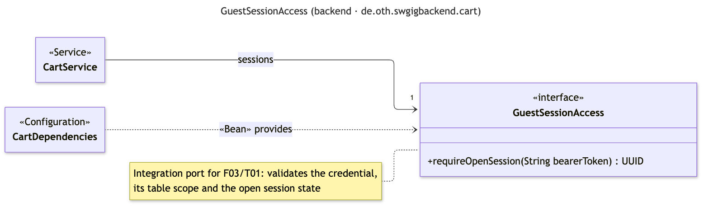

### CartDependencies
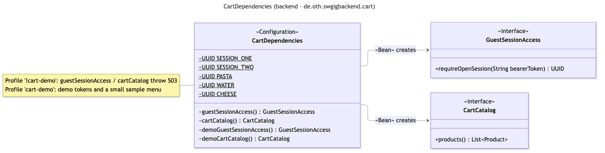

### OrderDraft
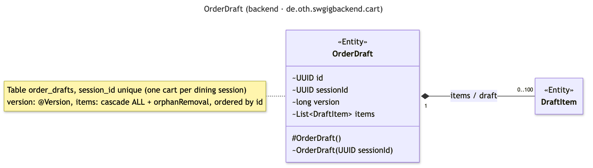

### DraftItem
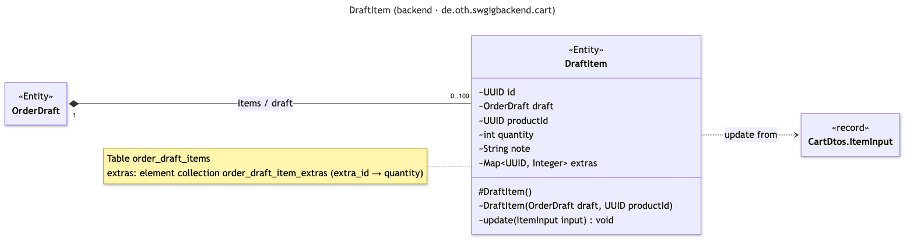

### OrderDraftRepository
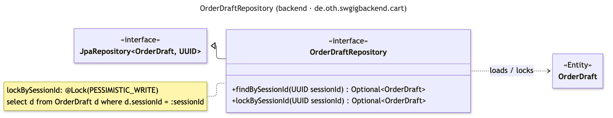

## Frontend (`frontend/src/app/cart`)

| Class | Kind | Diagram |
|---|---|---|
| `CartApi` (+ `Cart`, `CartItem`, `ItemInput`, `Product`, `Extra`, `ProductPage`) | Angular service + API models | [CartApi.png](CartApi.png) |
| `CartPage` | Angular component | [CartPage.png](CartPage.png) |
| `ItemEditor` | Angular component | [ItemEditor.png](ItemEditor.png) |

### CartApi
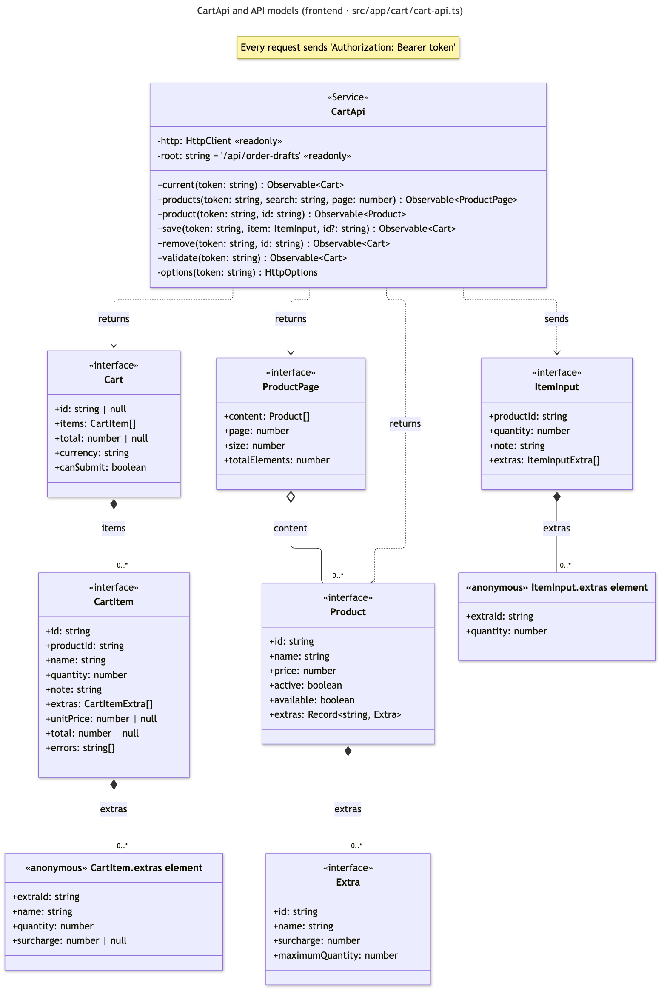

### CartPage
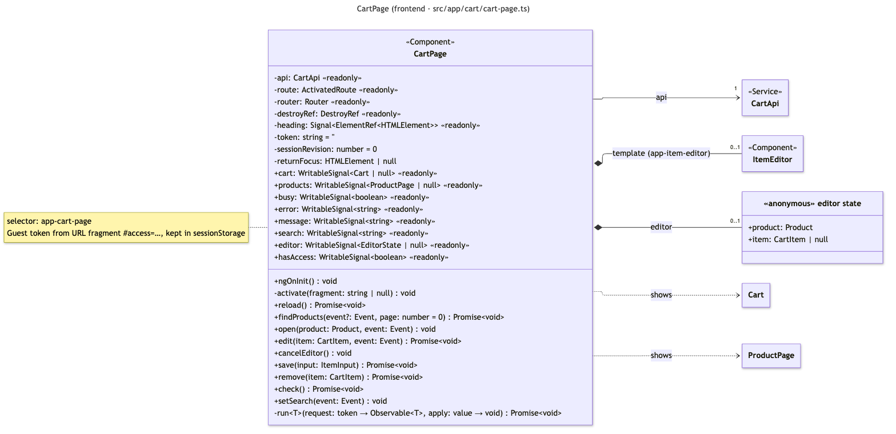

### ItemEditor
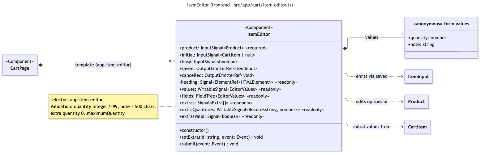
